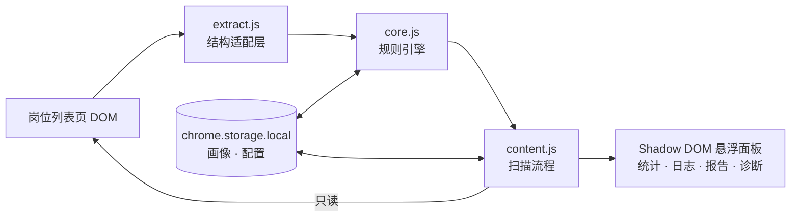
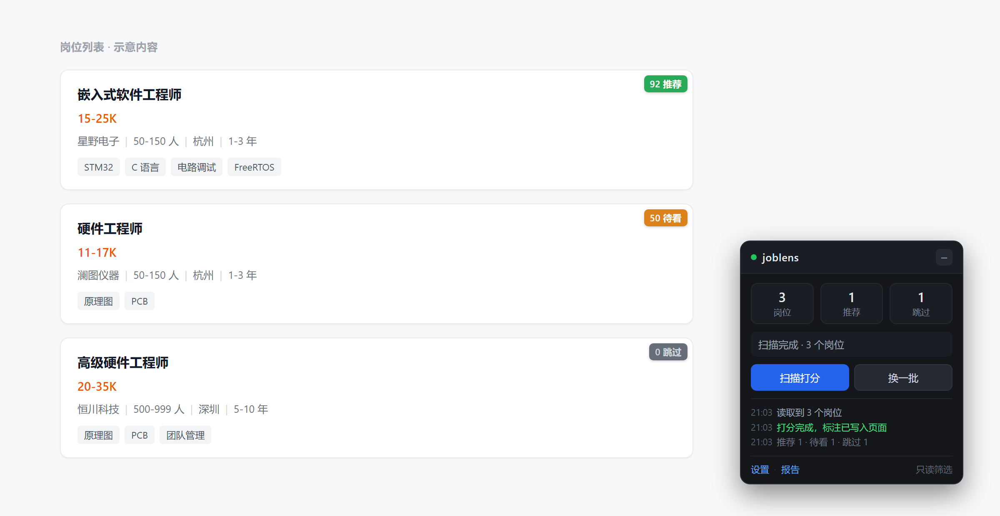

# joblens · 岗位透镜

**招聘网站上的本地岗位筛选与标注扩展。**
在你**自己已登录的浏览器**里给岗位打分、打徽章，把一屏几十个岗位在十秒内分成「值得看 / 再看看 / 跳过」。规则、画像、报告全部留在本机。

> **它只读。** v2.0 起不含任何点击岗位、发起沟通、发送消息的代码：不模拟点击、不填输入框、不调平台接口。你能做的操作，仍然是你自己点。

当前适配站点是 BOSS 直聘（`zhipin.com`）。本项目与其运营方无任何关联，也未获其授权或背书；相关名称、商标归各自所有者。使用前请自行确认符合该站服务条款。

[](https://github.com/yunchuanli003/joblens/actions/workflows/ci.yml)




四层单向依赖：`core.js` 不认识 DOM，`extract.js` 不认识业务规则，`content.js` 不认识选择器。所以抽取层能整体换掉（换站点），规则层能在 Node 里纯单测，流程层能拿 jsdom 跑完整链路。细节见 [docs/ARCHITECTURE.md](docs/ARCHITECTURE.md)。

## 界面

<p align="center">
  
</p>

<p align="center">
  <sub>右下角是悬浮面板；扫描后每张卡右上角出现徽章：<b>绿=推荐</b> · <b>橙=待看</b> · <b>灰=跳过</b>。鼠标悬停徽章可看这一分的理由。</sub>
</p>

> 图为**纯 HTML 复刻的界面示意**（[源文件](docs/assets/panel-preview.html)），不是平台截图，也不含真实岗位、真实公司或任何用户数据。面板的尺寸、配色、字号取自扩展本体 CSS，徽章规则取自 `.bs-badge`。

## 它做什么

| 能力 | 说明 |
|---|---|
| **本地打分** | 偏好 / 回避 / 排除词、薪资下限、标题核心词，规则命中即给出分数与**理由**，同一份输入永远同一份结果 |
| **卡片标注** | 扫描后每张卡右上角出现徽章：绿=推荐、橙=待看、灰=跳过，不点开也能一眼筛完一屏 |
| **HR 活跃度** | 卡片上的「3日内活跃 / 本月活跃 / 半年前活跃」换算成天数，超过门槛（默认 14 天）直接标为跳过；认不出档位的照常打分 |
| **跨轮去重** | `jobId` + `标题\|公司` 双键，同一岗位滚两次只算一个，换一批也不会重复列 |
| **换一批** | 滚到底自动加载 → 加载更多 → 下一页 → 换关键词 / 城市，四招依次试，到底了会告诉你改哪个条件 |
| **可诊断** | 一份纯文本扫描报告 + 一份 DOM 结构诊断；选择器失配时能直接看出「扫到 0 个」是哪一环断的 |

## 它刻意不做

- **不点击岗位**。扫描只读已经渲染出来的卡片，不触发任何卡片点击或页面跳转。
- **不发起沟通**。没有输入框注入、没有发送、没有招呼语模板——这部分能力在 v2.0 整体移除。
- **不绕验证**。遇到验证码 / 安全校验页只报错停手，不做识别、不做重试。
- **不伪造环境**。没有 UA / 指纹伪装，没有代理池，没有多账号。
- **不外传数据**。没有后端、没有埋点、没有远程配置；除页面自身加载外没有任何出网请求。
- **不申请多余权限**。只有 `storage` 和 `https://www.zhipin.com/*`——没有 `debugger`、`tabs`、`webRequest`、`<all_urls>`。

## 快速开始

**装扩展**（不需要 Node，也不需要打包）：

1. 打开 `chrome://extensions/`（Edge 用 `edge://extensions/`）→ 开启「开发人员模式」
2. 「加载解压缩的扩展」→ 选择仓库根目录（`manifest.json` 就在根目录，Chrome 只加载它引用的文件，README 和 docs 不影响）
3. 首次加载会自动打开设置页，填画像（**标题核心**最容易漏，它决定标题级误判挡不挡得住）
4. 打开 `https://www.zhipin.com/web/geek/jobs?query=你的搜索词` → 点悬浮面板「扫描打分」

**想跑测试或自己打包**：

```bash
npm install            # 只为测试，扩展本身零依赖；需要 Node 22+（jsdom 30 的依赖要求）
npm run verify         # 自检（语法 / manifest / 权限 / 版本 / 文档链接）+ 四套测试 310 项
npm run build          # 产出 dist/unpacked（可直接加载）
```

扩展本体就是 `manifest.json` + 几个 js 文件，没有构建步骤；上面的 `npm` 命令只服务于测试与发布。

## 三个值得一读的设计

**1. 只读是一条物理边界，不是一句承诺。**
`content.js` 里没有任何 `click()` / `dispatchEvent` / `fill` 调用，也没有 `<input>` 写入路径；`extract.js` 的导出表里没有「找沟通按钮」这类函数。这不是靠开关关掉的，是代码里不存在。测试里有一条专门断言「扫描全过程卡片点击次数为 0」。

**2. 选择器全部集中在 `SEL` 表，且每项都有回退。**
站点改版是常态，所以 `extract.js` 里每个字段都是 2~3 级回退（类名 → 属性 → 文本特征）。结构变了只改表，不动流程。

**3. 分数必须带理由。**
`evaluate()` 返回 `{ verdict, score, reasons }`，报告里每条都写着「命中哪个词、加了几分」。不可解释的打分等于没有打分——你没法判断是自己写错了规则，还是工具坏了。

更多：为什么是扩展而不是 CDP/Playwright、为什么本地规则而不调模型、为什么零依赖——见 [docs/DESIGN.md](docs/DESIGN.md)。

## 边界与限制

| 项 | 现状 |
|---|---|
| 站点 | 只适配 BOSS 直聘列表页（`/web/geek/jobs`）；推荐页部分可用，其他站点未适配 |
| 选择器 | 全部集中在 `src/extract.js` 的 `SEL` 表，各有 2~3 级回退；但**未经真实登录态全面验证**，结构变了改表即可 |
| 薪资解密 | 依赖站点把数字映射到私用区字符（U+E031~U+E03A）；映射变了要在设置页改，识别不出来会标「薪资存疑」 |
| 扫描上限 | 单次默认最多 120 个岗位、滚动 8 轮，可在设置页调 |
| 不做 OCR / 不做模型 | 纯规则，所以边界很明确：词表没覆盖到的岗位会判成「待看」，不会瞎猜 |

## 开发

```bash
npm install            # 只为跑测试
npm run verify         # 自检（语法 / manifest 引用 / 权限白名单 / 版本一致）+ 四套测试
npm test               # 只跑测试
npm run build          # 打包 dist/unpacked（只含扩展必需文件）
npm run icons          # 重新生成图标（需要 Python）
```

| 测试 | 项数 | 覆盖 |
|---|---|---|
| `tests/core.test.js` | 193 | 薪资解析、PUA 解密、打分规则、HR 活跃档位、报告格式、路径诊断、城市轮换 |
| `tests/extract.test.js` | 68 | 选择器回退、可见性、jobId 解析、卡片抽取、详情面板、分页控件、诊断输出 |
| `tests/flow.test.js` | 28 | 全链路：注入面板 → 扫描 → 标注 → 统计 → 报告 → 配置热更新；并断言全程零点击 |
| `tests/ui.test.js` | 21 | popup 状态与按钮、设置页回填 / chips / 校验 / 保存；并断言两个页面都没有投递入口 |

没有 E2E：真实 DOM 每天在变，拿它做断言等于把测试绑在会漂移的目标上。做法是反过来——**每次真机故障都先写成一条 jsdom 夹具**，再修到用例变绿。变更记录见 [CHANGELOG.md](CHANGELOG.md)。

## 文档

| 文件 | 内容 |
|---|---|
| [docs/USAGE.md](docs/USAGE.md) | 安装、画像七项、换一批、报告与诊断、排错手册 |
| [docs/ARCHITECTURE.md](docs/ARCHITECTURE.md) | 分层、扫描时序、三条不变量、存储结构、测试策略 |
| [docs/DESIGN.md](docs/DESIGN.md) | 设计与取舍：为什么是扩展、为什么本地规则、为什么只读、明确不做什么 |
| [CHANGELOG.md](CHANGELOG.md) | 每个版本按「现象 → 根因 → 改动」记录 |

## 许可

[MIT](LICENSE)。仅供个人求职效率参考，使用风险自负。

- 与任何招聘平台均无关联、未获授权或背书，不包含任何平台的源代码、接口文档或素材。
- 请在使用前阅读目标平台的服务条款；因使用本工具导致的账号限制、数据损失等后果由使用者承担。
- 仓库中的示例公司、岗位、HR 均为虚构，仅用于测试。
