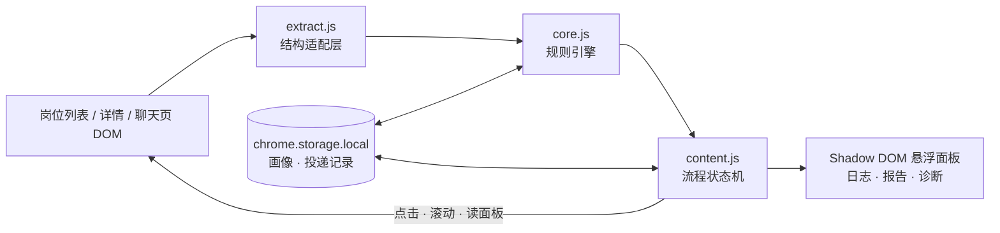

# boss-scout

**BOSS 直聘的本地岗位筛选与半自动沟通扩展。**
在你**自己已登录的浏览器**里给岗位打分、标注，再按节流节奏逐个发起沟通。规则、记录、画像全部留在本机。




四层单向依赖：`core.js` 不认识 DOM，`extract.js` 不认识业务规则，`content.js` 不认识选择器。所以抽取层能整体换掉（换站点），规则层能在 Node 里纯单测，流程层能拿 jsdom 跑完整链路。细节见 [docs/ARCHITECTURE.md](docs/ARCHITECTURE.md)。

## 它做什么

| 能力 | 说明 |
|---|---|
| **本地打分** | 偏好 / 回避 / 排除词、薪资下限、标题核心词，规则命中即给出分数与**理由**，同一份输入永远同一份结果 |
| **卡片标注** | 扫描后每张卡右上角出现徽章：绿=推荐、橙=待看、灰=跳过，不点开也能一眼筛完一屏 |
| **克制投递** | 单轮 8 份、每日 30 份、12~30 秒随机间隔、每 8 份休息、连续失败 3 次熔断 |
| **JD 复核** | 投之前直读详情页 JD 全文重新打分，不达阈值就跳过（此时连卡片都不点） |
| **跨轮去重** | `jobId` + `标题\|公司` 双键，已投的永不重投，同一岗位两张卡也不会重复 |
| **可诊断** | 一份纯文本报告 + 一份 DOM 结构诊断，失败时打出「试过哪些目标、每个候选多少字、链接指向哪」 |

## 它刻意不做

- **不海投**。8 / 30 是硬闸门，不是建议值。
- **不绕验证**。验证码、安全校验、平台上限弹窗一律停手，交给人。
- **不伪造环境**。没有 UA / 指纹伪装，没有代理池，没有多账号。
- **不外传数据**。没有后端、没有埋点、没有远程配置；除对 `zhipin.com` 的同源请求外没有任何出网流量。
- **不申请多余权限**。只有 `storage` 和 `https://www.zhipin.com/*`——没有 `debugger`、`tabs`、`webRequest`、`<all_urls>`。

## 快速开始

```bash
git clone <this-repo> && cd boss-scout
npm run build          # 可选：产出 dist/unpacked 与 dist/boss-scout-1.4.7.zip
```

1. 打开 `chrome://extensions/`（Edge 用 `edge://extensions/`）→ 开启「开发人员模式」
2. 「加载解压缩的扩展」→ 选择仓库根目录（或 `dist/unpacked/`）
3. 首次加载会自动打开设置页，填六项画像（**标题核心**最容易漏，它决定标题级误判挡不挡得住）
4. 打开 `https://www.zhipin.com/web/geek/jobs?query=你的搜索词` → 点悬浮面板「扫描打分」

不需要装依赖、不需要 Node、不需要 Python。扩展本体就是 `manifest.json` + 几个 js 文件；`npm` 只用于跑测试和打包。

## 三个值得一读的设计

**1. 读 JD 不依赖右侧面板。**
先直接 `GET /job_detail/<jobId>.html` 解析 `.job-sec-text`——不点卡片、不等面板、不跳页，页面结构怎么改都不影响。请求不到才退回「点开卡片读面板」，而面板又从七八个同名容器里按「含 JD 段落 → 最内层」择优，不会读到一个永不变化的壳。

**2. 点击目标链，而不是一个选择器。**
BOSS 各版本把点击监听绑在容器 / `li` / 标题 / 详情链接上。四个目标依次试，观察窗口按剩余时间平摊；点 `<a>` 时用 `preventDefault` 拦掉整页导航（不阻断冒泡），否则脚本上下文被销毁，表现就是「点了没反应」。

**3. 「按钮点过」不算投递成功。**
网页版「立即沟通」只跳到聊天页，一句话都没发出去。所以必须找到输入框、写进去、发出、再用三条证据验证（框被清空 / 消息出现 / 会话多一条）才记 +1。任何一步失败都记 `greeting_failed`，不占额度，下一轮重试。

更多：为什么是扩展而不是 CDP/Playwright、为什么本地规则而不调模型、为什么零依赖——见 [docs/DESIGN.md](docs/DESIGN.md)。

## 边界与限制

| 项 | 现状 |
|---|---|
| 单轮 / 每日上限 | 8 份 / 30 份，可在设置页调整（每日不可超过 30） |
| 投递间隔 | 12~30 秒随机 + ±25% 抖动，每 8 份休息 1~2.5 分钟 |
| 遇验证 / 上限弹窗 | 立即停，不重试、不绕过 |
| 选择器 | 全部集中在 `src/extract.js` 的 `SEL` 表，各有 2~3 级回退；但**未经真实登录态全面验证**，结构变了改表即可 |
| `isTrusted` | 扩展发出的点击仍是 `false`，这是扩展 API 的硬限制，任何「和真人点击完全一致」的说法都不成立 |
| 风险 | 风控是概率问题。降低概率靠的是**总量小、节奏稳、语义筛选**，不是这个工具本身 |

> 这个工具仍然属于自动化操作，可能违反平台用户协议。默认参数是为了把单日行为压在正常求职者的量级，不是为了让高频投递变得安全。请用小号先试，投完人工核对几家。

## 开发

```bash
npm install            # 只为跑测试
npm run verify         # 自检（语法 / manifest 引用 / 权限白名单 / 版本一致）+ 四套测试
npm test               # 只跑测试
npm run build          # 打包 dist/unpacked 与 dist/boss-scout-<version>.zip
npm run icons          # 重新生成图标（需要 Python）
```

| 测试 | 项数 | 覆盖 |
|---|---|---|
| `tests/core.test.js` | 188 | 薪资解析、PUA 解密、打分、招呼语、弹窗分类、探针、配置合并、报告格式 |
| `tests/extract.test.js` | 122 | 选择器回退、可见性、jobId 解析、按钮查找、点击目标链、聊天页输入框、滚动容器、诊断输出 |
| `tests/flow.test.js` | 107 | 全链路：扫描 → 标注 → 报告 → 投递 → 落库 → 去重 → SPA 跳转 → 换一批 → 发招呼语 → 交给 BOSS |
| `tests/ui.test.js` | 68 | popup 状态、报告面板、诊断面板、设置页回填 / 校验 / 保存 / 节奏档位 |

没有 E2E：真实 DOM 每天在变，拿它做断言等于把测试绑在会漂移的目标上。做法是反过来——**每次真机故障都先写成一条 jsdom 夹具**，再修到用例变绿。485 项测试几乎每一组都对应一次线上问题，变更记录见 [CHANGELOG.md](CHANGELOG.md)。

## 文档

| 文件 | 内容 |
|---|---|
| [docs/USAGE.md](docs/USAGE.md) | 安装、画像六项、节奏三档、换一批、招呼语两种模式、排错手册 |
| [docs/ARCHITECTURE.md](docs/ARCHITECTURE.md) | 分层、扫描与投递时序、三条不变量、存储结构、测试策略 |
| [docs/DESIGN.md](docs/DESIGN.md) | 设计与取舍：为什么是扩展、为什么本地规则、为什么双键去重、明确不做什么 |
| [CHANGELOG.md](CHANGELOG.md) | 每个版本按「现象 → 根因 → 改动」记录 |

## 许可

[MIT](LICENSE)。仅供个人求职效率参考，使用风险自负。
