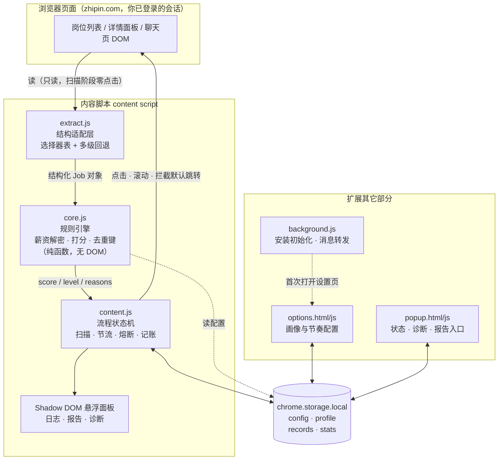
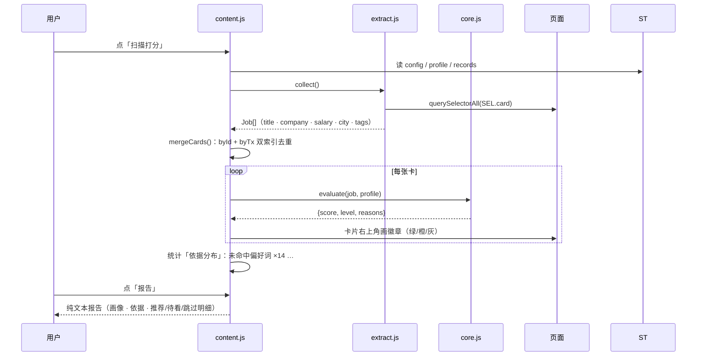
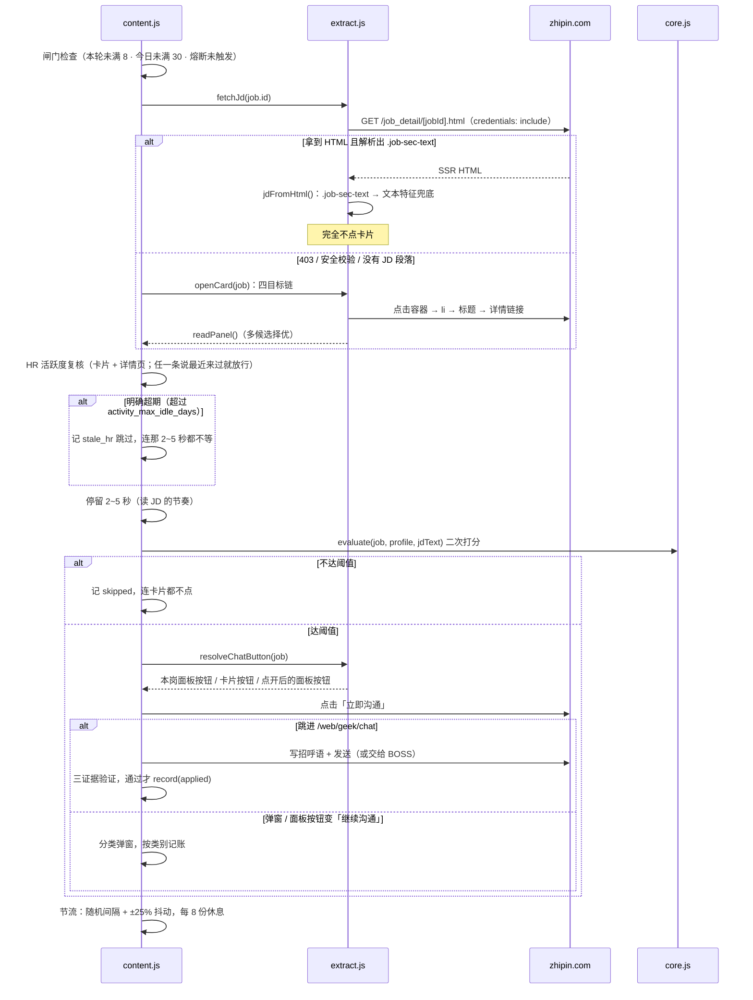

# 架构与数据流

四层、单向依赖、没有构建步骤。想看「为什么这么切」请看 [DESIGN.md](DESIGN.md)。

## 分层



依赖方向是硬的：`core.js` 不认识 DOM，`extract.js` 不认识业务规则，`content.js` 不认识选择器常量。违反这条的几个具体好处是：

- `core.js` 可以在 Node 里直接单测（221 项，不碰 jsdom）
- 换一个网站（结构完全不同）只需要重写 `extract.js`
- 调打分公式不会碰到任何点击逻辑

## 一次「扫描打分」



扫描阶段**完全不点击、不滚动到底**（滚动是「换一批」的职责），只读 DOM 并画徽章。

## 投一份的时序



## 三条不变量

这三条是反复修 bug 修出来的，改动时必须守住。

### 1. 只有拿到证据才记账

「点了按钮」不等于「投递成功」。网页版「立即沟通」只是跳到聊天页，一句话都没发出去。所以 `record({ok:true})` 只在这几种情况下发生：

| 证据 | 代码位置 |
|---|---|
| 输入框被清空 / 消息列表出现这句话 / 会话多了一条 | `sendGreetingInChat` |
| 聊天页出现输入框（同时勾了「交给 BOSS」） | `handoffGreeting` |
| 弹窗分类为 `continue` 且点了确认 | `clickAndFinish` |
| 面板按钮文案发生变化 | `clickAndFinish` |

否则记 `greeting_failed` / `unconfirmed` / `no_button`，不占额度，下一轮重试。

### 2. 终止态只增不减

`applied` 与 `already_contacted` 都算终止态：一旦写下，这个岗位不会再进入任何一轮的队列。判定走 `isDone()`，同时查 `id:` 与 `tx:` 两套键。

### 3. 单飞

`State.running` 为真时再点「开始投递」直接返回；`State.busy` 标出「页面正被我们驱动」的时段，此间的 URL 变化不触发「用户切页」熔断。

## 本地存储

全部在 `chrome.storage.local`，四个键：

| 键 | 内容 | 谁写 |
|---|---|---|
| `config` | `limits`（8 / 30 / 滚动轮数 / 面板等待）、`pacing`（间隔、休息、读 JD 停留）、`safety`（熔断阈值、`handoff_greeting`）、`scoring`（阈值、权重）、`puaMap`（薪资字体映射） | 设置页 |
| `profile` | `title_core`、`prefer`、`avoid`、`must_have`、`reject_keywords`、`target_cities`、`min_salary_k`、`activity_max_idle_days`、`experience`、`greeting_template` | 设置页 |
| `records` | 以 `id:<jobId>` 或 `tx:<标题>\|<公司>` 为键，值为 `{title, company, status, ts, ...}` | content.js |
| `stats` | `{date, applied}`，跨天自动归零 | content.js |

没有第五个键，也没有任何出网请求——除了对 `zhipin.com` 本身的同源 `fetch`。

## 测试策略

```
tests/core.test.js      221 项   纯函数：薪资解密、PUA 映射、打分、HR 活跃档位、招呼语、弹窗分类、URL 探针、配置合并、报告格式
tests/extract.test.js   132 项   jsdom：选择器回退、可见性、jobId 解析、按钮查找、点击目标链、聊天页输入框、滚动容器、诊断输出
tests/flow.test.js      115 项   jsdom + 假 chrome API：扫描 → 标注 → 报告 → 投递 → 落库 → 去重 → SPA 跳转 → 换一批 → 发招呼语
tests/ui.test.js         70 项   jsdom：popup 状态、报告面板、诊断面板、设置页回填 / 校验 / 保存 / 节奏档位
```

**为什么没有 E2E（真浏览器 + 真账号）**：因为它不可重复。这类工具 90% 的 bug 是「这个版本的 DOM 和我以为的不一样」，而真实 DOM 每天都在变，拿它做断言等于把测试绑在一个会漂移的目标上。

折中办法是：**用 jsdom 重构出「我以为的 DOM」，再让真实页面来打脸**。每次真机出问题，第一件事是把这个现场写成一条 jsdom 夹具（为什么点不到、面板为什么读到壳），然后修到用例变绿。538 项测试里，几乎每一组都对应一次真机故障。

## 目录

```
joblens/
  manifest.json          MV3，只有 storage 权限 + zhipin.com host 权限
  src/
    core.js              纯逻辑：薪资、解密、打分、招呼语、弹窗分类（无 DOM 依赖）
    extract.js           页面结构假设：选择器表、卡片抽取、按钮/弹窗定位、JD 直读
    content.js           流程与 UI：扫描、投递循环、节奏、熔断、悬浮面板
    background.js        安装初始化 + 消息转发
    popup.html/js        状态面板
    options.html/js      设置与画像
  tests/                 四套测试（core / extract / flow / ui）
  scripts/
    check.mjs            语法 + manifest 引用 + 权限白名单 + 版本一致性
    build.mjs            零依赖打包（dist/unpacked + dist/*.zip）
    make-icons.py        生成扩展图标（纯标准库）
  docs/                  设计 / 架构 / 使用
```
